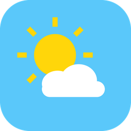
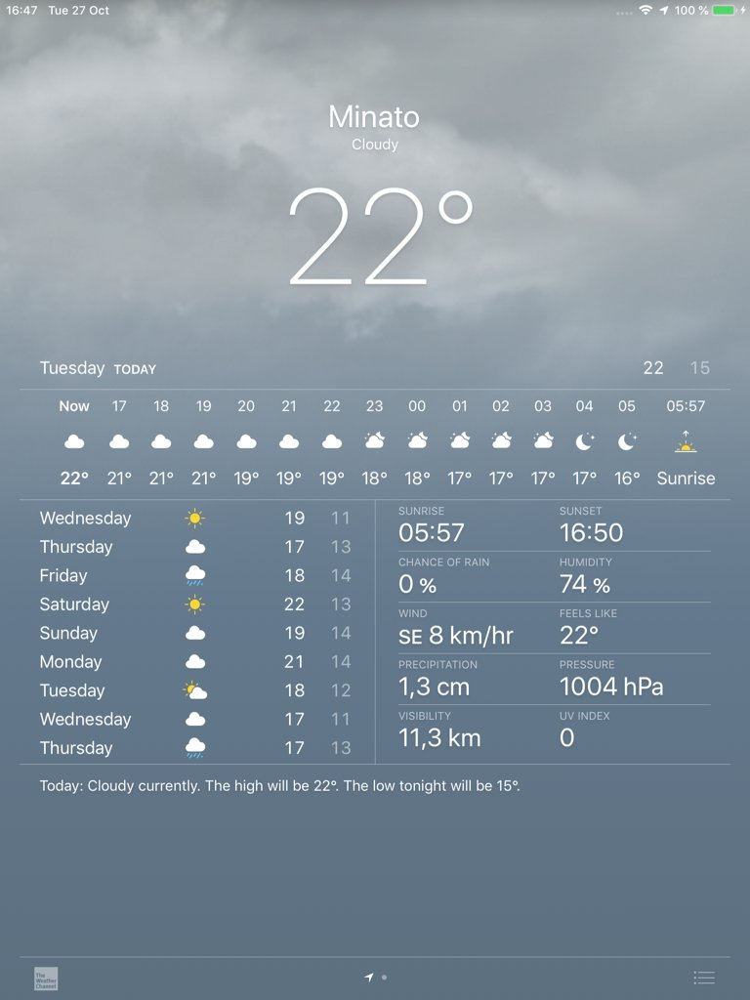
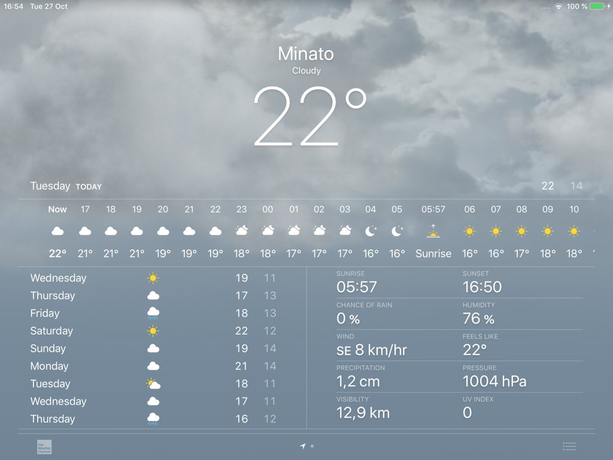
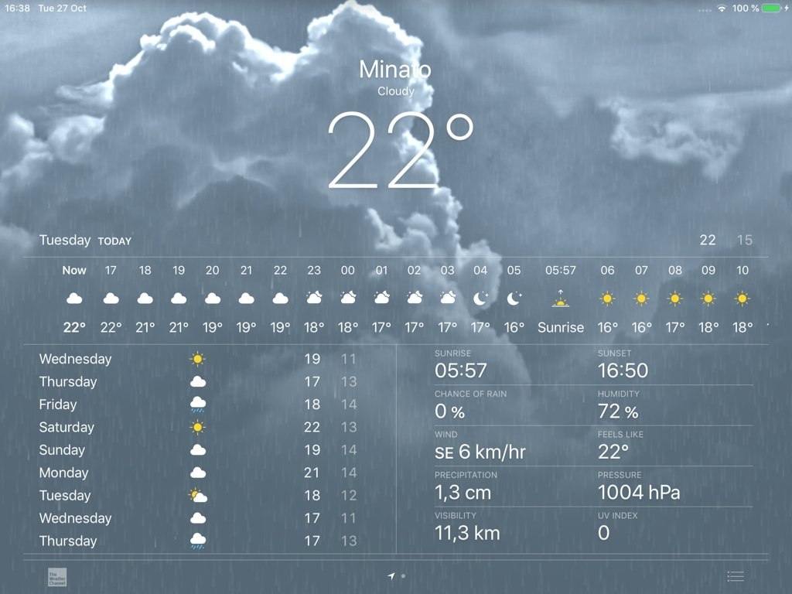
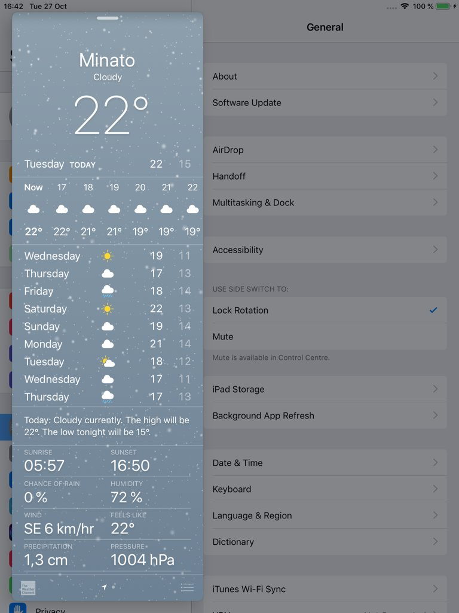
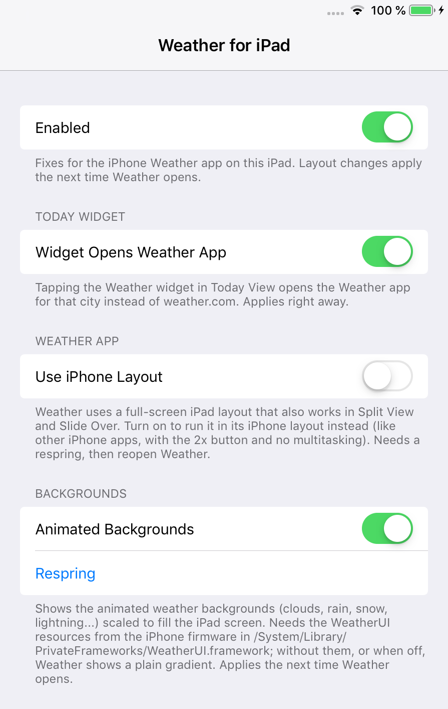

<p align="center"></p>

<h1 align="center">WeatherPad (iOS 12)</h1>

**Apple's iPhone Weather app, running natively on iPad.**

iPads on iOS 12 have no Weather app. WeatherPad takes Apple's iPhone Weather app for iOS 12 and makes it behave like a real iPad app: it fills the whole screen, uses a two-column layout on the big screen, works in portrait and landscape, and adapts to Split View and Slide Over. The animated weather backgrounds (clouds, rain, snow, lightning) fill the screen too.

This is an unofficial jailbreak tweak. It is not affiliated with or endorsed by Apple.

> **You need the Weather app first.** WeatherPad needs Apple's iPhone Weather app on the iPad; `installer/install-weather.sh` downloads it and its animated backgrounds directly from Apple and installs them. Apple's files are not included in this repo. See [installer/README.md](installer/README.md).

## Screenshots

| Portrait | Landscape |
| --- | --- |
|  |  |

| Animated backgrounds | Slide Over |
| --- | --- |
|  |  |

Settings > Weather for iPad:



## Features

- **Adaptive iPad layout.** When the window is at least 660 points wide, the forecast uses two columns: the hourly forecast across the top, the daily forecast and the details side by side below. Narrower windows use the iPhone layouts.
- **Works everywhere.** Portrait, landscape, Split View and Slide Over, including resizing with the divider.
- **Weather widget opens the app.** On iPad, tapping the Weather widget in Today View normally opens weather.com in Safari. With WeatherPad it opens the Weather app for that city.
- **Animated backgrounds that fill the iPad.** The iPhone backgrounds are made for phone screens; WeatherPad scales them up so they cover the whole iPad. Can be turned off in Settings.
- **Header fade and snap fixes.** While you scroll, the big temperature fades out and the header snaps open or closed, like on iPhone.
- **"Use iPhone Layout" switch** if you prefer to run Weather like any other iPhone app.

## Compatibility

- Tested on an iPad mini 2 with iOS 12.5.8, jailbroken with checkra1n + odysseyra1n (libhooker).
- Expected to work on iPads running iOS 12.x.
- Needs Apple's iPhone Weather app for iOS 12, installed with the [installer](installer/README.md). Without it, WeatherPad does nothing.
- The animated backgrounds need the background files the installer also downloads. Without them, Weather shows a plain gradient.

## Install

1. Add the **iOS Legacy** source to your package manager and install WeatherPad:

   ```
   https://itsallexb.github.io/ios-legacy/
   ```

   One tap on your device: [Add to Sileo](https://itsallexb.github.io/ios-legacy/add/sileo.html) · [Add to Zebra](https://itsallexb.github.io/ios-legacy/add/zebra.html) · [Add to Cydia](https://itsallexb.github.io/ios-legacy/add/cydia.html)

   Or download the `.deb` from [Releases](https://github.com/itsAllexB/WeatherPad-iOS12/releases/latest) and install it with Filza or `dpkg -i`, then respring.

2. Install the Weather app and its backgrounds with the installer on your Mac. Follow [installer/README.md](installer/README.md).

Requires `mobilesubstrate` (Substrate, Substitute or libhooker) and PreferenceLoader. Your package manager installs them automatically.

## Settings

Open **Settings > Weather for iPad**:

- **Enabled**: turns all of WeatherPad's fixes on or off. Layout changes apply the next time Weather opens.
- **Widget Opens Weather App**: tapping the Weather widget in Today View opens the Weather app for that city instead of weather.com. Applies right away.
- **Use iPhone Layout**: runs Weather in its iPhone layout (like other iPhone apps, with the 2x button and no multitasking) instead of the iPad layout. Needs a respring, then reopen Weather.
- **Animated Backgrounds**: shows the animated weather backgrounds scaled to fill the screen. Applies the next time Weather opens.
- **Respring**: restarts SpringBoard (no reboot).

## Build from source

You need [Theos](https://theos.dev/docs/installation) and an iOS SDK (the Makefile uses the iOS 14.5 SDK and targets iOS 12.0, arm64).

```sh
git clone https://github.com/itsAllexB/WeatherPad-iOS12.git
cd WeatherPad-iOS12
make package FINALPACKAGE=1
```

The package is written to `packages/`. To install it on a device over SSH, set `THEOS_DEVICE_IP` and run `make install`.

What's in this repo:

- `Tweak.x`: the tweak. It loads into three processes only: SpringBoard (the iPhone-layout option), the Weather app (layout, backgrounds, scrolling) and the Weather widget (opening the app). The comments explain each fix in detail.
- `prefs/`, `layout/`: the Settings page.
- `installer/`: the Weather app installer, plus the launch screen it adds to the app (`installer/launch/`). iPad apps that support Split View need a launch storyboard.

## Credits and license

Made by [itsAllexB](https://github.com/itsAllexB).

WeatherPad is free software under the GNU General Public License v3.0 or later. See [LICENSE](LICENSE). The license covers the code in this repo only. The Weather app and its backgrounds belong to Apple and are not part of this project.

iPad and iPhone are trademarks of Apple Inc. This project is not affiliated with Apple.
